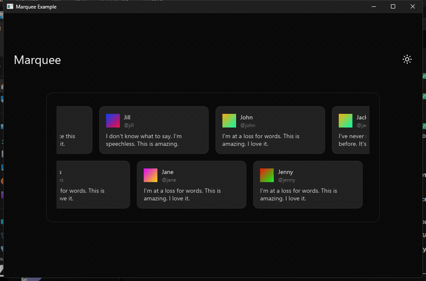

# enchant

<p align="center">
  <strong>Premium interaction layer for iced</strong><br>
  <i>Animated text, glow surfaces, patterned backgrounds, and builder-first widgets</i>
</p>

<p align="center">
  <a href="https://crates.io/crates/enchant-iced"></a>
  <a href="https://docs.rs/enchant-iced"></a>
  <a href="https://opensource.org/licenses/MIT"></a>
</p>

<p align="center">
  <picture>
    
  </picture>
  <br>
  <sub>marquee — one of 84 captured example demos</sub>
</p>

---

> [!WARNING]
> API STABILITY NOTICE: `enchant-iced` API is currently unstable and may change between versions, including breaking changes.
> Always pin exact crate versions and review release notes before upgrading.

## Overview

`enchant` is a workspace whose public library crate is [`enchant-iced`](crates/enchant-iced): a premium interaction layer for [`iced`](https://github.com/iced-rs/iced), porting surfaces from [Magic UI](https://magicui.design) and [Libraries.dev](https://libraries.dev).

- builder-first widget API per component
- examples under `crates/enchant-iced/examples/` (one runnable demo per component or scenario)
- decorative surfaces via [`iced-shadcn`](https://github.com/FerrisMind/shadcn-rs); style tokens via [`twill`](https://github.com/FerrisMind/twill)

See the crate README for installation, feature flags, platform notes, and the full demo gallery:

**[crates/enchant-iced/README.md](crates/enchant-iced/README.md)**

## Workspace layout

- `crates/enchant-iced` — library crate (widgets, primitives, sections, theme helpers)

## Requirements

- Rust `1.93` or newer (edition 2024)
- A GPU/window backend supported by `iced` 0.14 (wgpu)

## Installation

```toml
[dependencies]
enchant-iced = "0.29"
iced = "0.14"
iced-shadcn = "0.5"
```

## Build and verify

```powershell
cargo check --workspace --all-targets
cargo test -p enchant-iced
cargo clippy -p enchant-iced --all-targets -- -D warnings
cargo fmt --all --check
```

## Run an example

```powershell
cargo run --example magic_card
cargo run --example animated_beam
cargo run --example bento_grid
```

`cargo run --example` with no name lists every example.

## Demos

Jump to the full gallery (TOC + every PNG/GIF capture):

**[Example demos →](crates/enchant-iced/README.md#demos)**

## Documentation

```powershell
cargo doc -p enchant-iced --no-deps --open
```

## Component status

Readiness is tracked at two levels:

- **Builds and runs** — CI compiles every user-facing example; `crates/enchant-iced/tests/example_inventory.rs` guards inventory drift
- **Verified against the Magic UI / [Libraries.dev](https://libraries.dev) references** — hand-checked via the launcher:

```powershell
python scripts/example_launcher.py
```

The ledger writes under `logs/` (gitignored).

## License

Dual-licensed under [MIT](https://opensource.org/licenses/MIT) OR [Apache-2.0](https://www.apache.org/licenses/LICENSE-2.0).

Third-party attribution (Magic UI, Libraries.dev, fonts, demo assets): see [`THIRD_PARTY_NOTICES.md`](THIRD_PARTY_NOTICES.md).

---

**Inspired by** [Magic UI](https://magicui.design) · [Libraries.dev](https://libraries.dev) ([source](https://github.com/Jakubantalik/Libraries.dev)) · **UI kit** [iced-shadcn](https://github.com/FerrisMind/shadcn-rs) · **Styling** [twill](https://github.com/FerrisMind/twill) · **Framework** [iced](https://github.com/iced-rs/iced)
